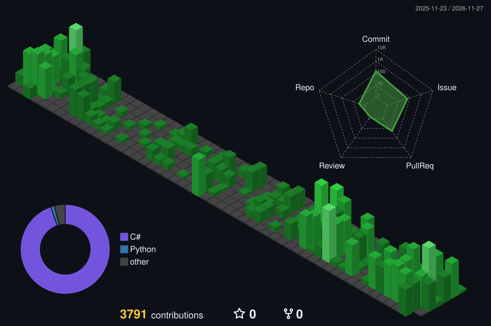

<div align="center">

  

  <p>
    <a href="https://www.linkedin.com/in/enes-karamanoglu/"></a>&nbsp;
    <a href="mailto:eneskaramanoglu@gmail.com"></a>&nbsp;
    <a href="https://github.com/eneskaramanoglu"></a>&nbsp;
    
  </p>

</div>


### `> whoami --profile`

```yaml
NAME       : Enes Karamanoğlu
ROLE       : Software Developer
FOCUS      : Backend Systems • AI & LLM Workflows • Web & Mobile Applications
ENVIRONMENT: Windows • Kubernetes (K8s) • Docker • Cloud-Native Microservices

CORE_WORKLOADS:
  - Backend    : Hexagonal Architecture (Ports & Adapters), DDD, Multi-Tenant SaaS (.NET 9 & Go)
  - AI_Systems : AI Agents, LLM Integrations, Automated Code Generation & Platform Tooling
  - Messaging  : Event-Driven Microservices, MassTransit, RabbitMQ (Outbox & Saga Patterns)
  - Frontend   : Enterprise Web Apps with Angular & TypeScript, Next.js, React & Mobile
  - Infra_Sec  : Kubernetes, Docker, HashiCorp Vault, Keycloak IAM, MinIO, Pact Testing
```


### `> stack --list`

<table width="100%">
  <tr>
    <td width="28%"><b><code>[01] Backend & Core</code></b></td>
    <td width="72%">
      <br/>
      
      
      
    </td>
  </tr>
  <tr>
    <td><b><code>[02] AI & Automation</code></b></td>
    <td>
      <br/>
      
      
      
    </td>
  </tr>
  <tr>
    <td><b><code>[03] Frontend & Mobile</code></b></td>
    <td>
      <br/>
      
      
      
    </td>
  </tr>
  <tr>
    <td><b><code>[04] Kubernetes & Data</code></b></td>
    <td>
      <br/>
      
      
      
      
      
    </td>
  </tr>
</table>


### `> status --focus`

```diff
+ [BACKEND]    Developing scalable multi-tenant microservices & event-driven pipelines (.NET, Go, RabbitMQ)
+ [AI & LLM]   Building AI-powered developer workflows, intelligent agents & automated platform tooling
+ [WEB & MOB]  Crafting enterprise web & mobile interfaces with Angular, TypeScript, Next.js & React
+ [KUBERNETES] Orchestrating containerized workloads on Kubernetes with Vault, Keycloak & CI/CD
```


### `> metrics --github`

<div align="center">
  
  
</div>

<div align="center">
  
</div>

<div align="center">
  
</div>


<div align="center">
  <code>[SESSION ACTIVE] — enes@dev:~ &gt; _</code>
</div>
